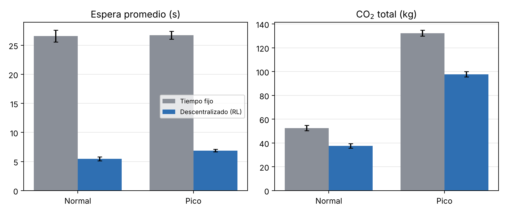

# Optimización de la red semafórica urbana mediante inteligencia artificial: evaluación de un sistema adaptativo en la ciudad de Mendoza

Código del trabajo. Se evalúa un **sistema de control semafórico descentralizado** basado en aprendizaje por
refuerzo (un agente Q-learning independiente por intersección) frente a la **semaforización de tiempo fijo**,
sobre una red de 4 intersecciones del centro de Luján de Cuyo, Mendoza, simulada en
[SUMO](https://eclipse.dev/sumo/) y controlada mediante TraCI.

## Entorno de simulación

Red de 4 intersecciones del centro de Luján de Cuyo, construida en SUMO como una grilla que reproduce la
disposición de cuadras y calles de la zona (geometría reconstruida manualmente, cuadras de 120 m):

- San Martín & Roque Sáenz Peña
- San Martín & España
- Taboada & Roque Sáenz Peña
- Taboada & España

San Martín es la avenida principal (2 carriles por sentido, 50 km/h). Las demás son calles locales
(1 carril por sentido, 40 km/h). Cada intersección tiene 4 aproximaciones: el eje vertical (San Martín y
Taboada) y el eje horizontal (Roque Sáenz Peña y España). Las emisiones de CO2 se estiman con el modelo
HBEFA integrado en SUMO.

## Arquitectura y agente (`src/agente.py`)

Cada intersección aloja su propia arquitectura de 4 capas, independiente de las demás:

1. **Captura:** obtiene el estado de la red desde la simulación.
2. **Procesamiento:** calcula los vehículos detenidos por carril, la ocupación de los carriles de salida y el tiempo transcurrido en la fase activa.
3. **Decisión:** el agente Q-learning tabular decide si mantiene o avanza la fase.
4. **Ejecución:** modifica la fase activa del semáforo.

| | |
|---|---|
| Agentes | 4, uno por intersección, entrenados de forma independiente |
| Estado | 3 variables discretas: cola del eje vertical y cola del eje horizontal (4 bins: 0 / 1-3 / 4-7 / 8+ vehículos detenidos) y fase actual |
| Acción | 2 alternativas: mantener la fase o avanzar a la siguiente (con 3 s de amarillo) |
| Decisión | cada 5 s, con un verde mínimo de 10 s |
| Recompensa | negativo de la cola total en las 4 aproximaciones de la intersección, sobre la totalidad de los accesos |
| Entrenamiento | 120 episodios de 1 h simulada por escenario (86.400 pasos de decisión por agente); α = 0,1, γ = 0,9, ε de 1,0 a 0,05 |

## Diseño experimental

- **Sistemas comparados:** tiempo fijo y sistema descentralizado. El tiempo fijo es el ciclo por defecto que genera la herramienta de compilación de la red: 90 s, con 42 s de verde y 3 s de amarillo por fase.
- **Demanda:** sintética, generada con un modelo gravitacional que pondera cada acceso según su jerarquía vial (San Martín con más peso que las calles locales). Hay dos escenarios de 1 hora simulada: tránsito normal (~450 veh/h) y hora pico (~1100 veh/h).
- **Vehículo tipo:** auto de pasajeros a nafta, clase de emisión HBEFA4 PC_petrol_Euro-6ab.
- **Variables dependientes:** tiempo promedio de espera, flujo vehicular por hora (viajes completados) y emisiones de CO2, en total y normalizadas por vehículo.
- **Evaluación:** el modelo entrenado en cada escenario usa la política greedy. Se evalúa en 10 semillas de demanda distintas de las de entrenamiento, y en esas mismas semillas se mide el tiempo fijo.

## Resultados obtenidos con este código (`resultados/`)

| Métrica | Normal Fijo | Normal RL | Pico Fijo | Pico RL |
|---|---|---|---|---|
| Espera promedio (s) | 26,6 | 5,5 | 26,7 | 6,9 |
| Flujo (veh/hora) | 448 | 448 | 1.097 | 1.097 |
| Viajes completados | 448 | 448 | 1.097 | 1.097 |
| CO2 total (kg) | 52,6 | 37,7 | 132,3 | 97,8 |
| CO2 por vehículo (g) | 117,4 | 84,0 | 120,6 | 89,2 |

Valores medios sobre 10 semillas de evaluación por escenario. Espera: −79,5 % (normal) y −74,2 % (pico).
CO2: −28,4 % y −26,1 %. El sistema descentralizado mejora al tiempo fijo en las 10 semillas de ambos
escenarios (Wilcoxon pareado, p = 0,002). Archivos de salida: `tabla1.md` y `tabla1.tex` (Tabla 1),
`figura1.png` (Figura 1), `curvas_aprendizaje.png`, `resumen.csv` y `evaluacion.csv`.



## Estructura

```
red/build_network.py         Construye la red (grilla de 4 intersecciones, ciclo fijo de 90 s)
demanda/generate_demand.py   Genera la demanda gravitacional (escenarios normal y pico)
escenarios/*.sumocfg         Configuración SUMO de cada escenario
src/agente.py                Arquitectura de 4 capas + agente Q-learning por intersección
src/experimento.py           Comandos: baseline | train | eval
src/run_all.py               Corre el experimento completo
src/analizar.py              Genera la Tabla 1, la Figura 1 y las curvas de aprendizaje
resultados/                  Resultados y modelos entrenados
```

## Cómo correrlo

Requiere Python 3.10 o superior. SUMO se instala con pip (`eclipse-sumo`).

**Linux / macOS / WSL**
```bash
python3 -m venv venv && source venv/bin/activate
pip install -r requirements.txt
python red/build_network.py
python demanda/generate_demand.py
python src/run_all.py --rapido     # prueba de ~1 minuto
python src/run_all.py              # experimento completo (~3-4 minutos)
```
En Ubuntu/WSL también se puede usar `bash instalar_wsl.sh`.

**Windows:** doble clic en `INSTALAR.bat` y después en `CORRER.bat`. Si Windows muestra *"Parte de esta
aplicación se ha bloqueado"*, es el Control inteligente de aplicaciones (Smart App Control), que bloquea las
DLL de SUMO instaladas por pip. En ese caso hay que usar WSL.

Comandos sueltos:
```bash
python src/experimento.py baseline --escenario pico --seed 101
python src/experimento.py train    --escenario pico --episodios 120 --seed 1
python src/experimento.py eval     --escenario pico --modelo resultados/modelos/pico_s1.pkl --seed 101
python src/analizar.py --out resultados
```
